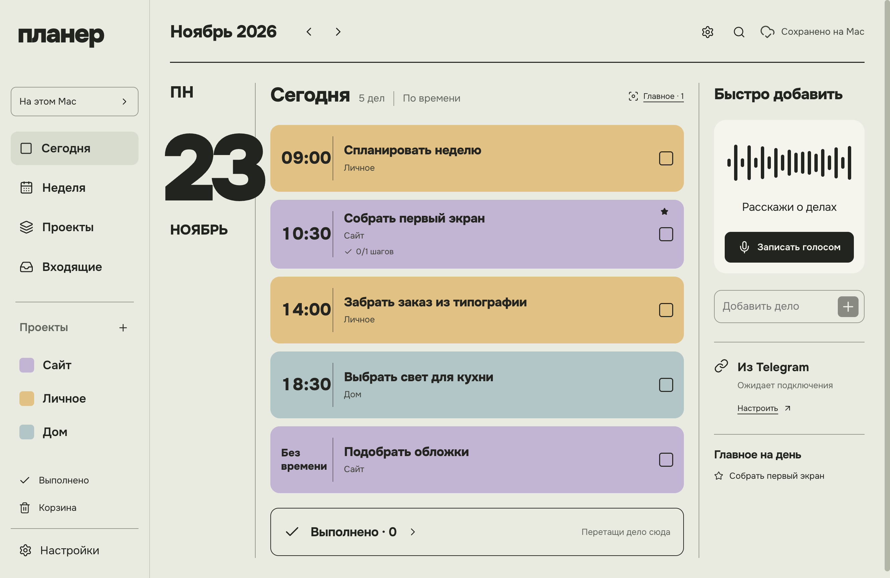
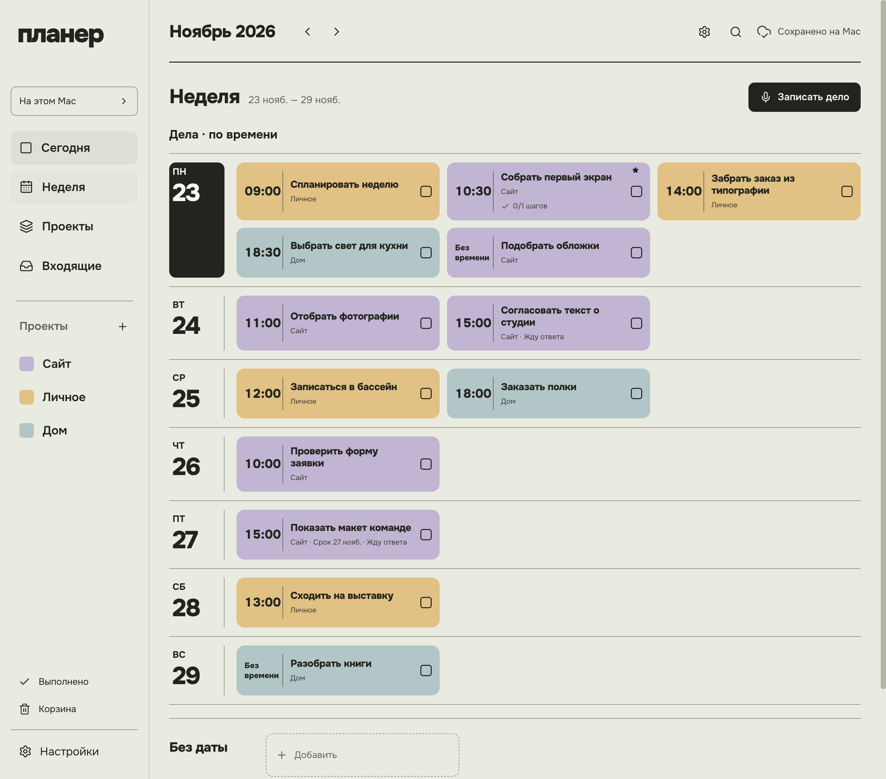
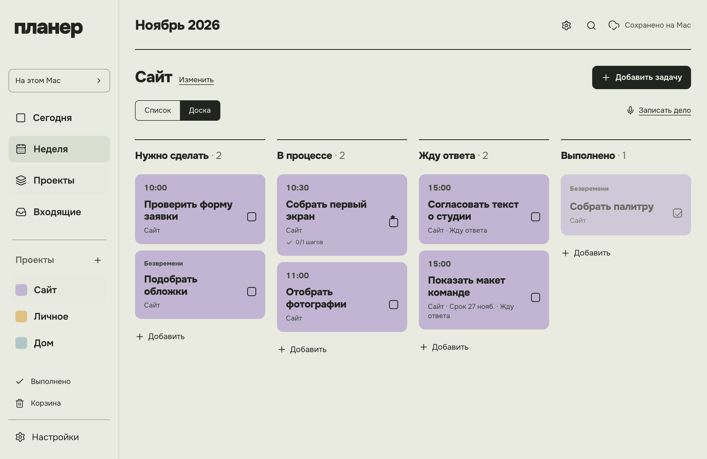
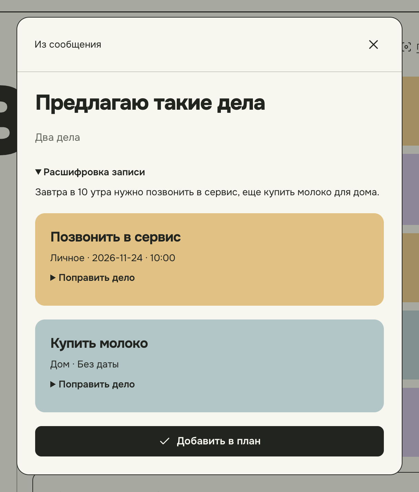

# Планер для Mac

Личный планер с локальным режимом: работает без хостинга, аккаунта и открытого чата. Те же экраны «Сегодня», «Неделя», проекты и доска, перетаскивание за любое место карточки с плавным переносом, подзадачи, повторы, поиск, история, корзина и запись голосовых заметок. На неделе четвёртая карточка переносится на следующую строку; дела идут по времени.

[Скачать Планер для Mac](https://github.com/egorchik10001/Planer/releases/latest) · [Как установить](#установка-готового-приложения)

## Как выглядит Планер

**Сегодня.** Дела идут по времени, цвет карточки показывает проект. Справа можно записать голосовое или быстро добавить задачу текстом.



**Неделя.** В понедельник пять дел, поэтому карточки занимают две строки. Ниже видны планы на остальные дни.



**Доска проекта.** Карточку можно взять в любом месте и перетащить в соседнюю колонку или в другой проект в боковом меню.



**Из голоса в задачи.** Из одной фразы Планер выделил звонок в сервис на завтра в 10:00 и покупку молока для дома. Перед добавлением можно свериться с расшифровкой и поправить каждое дело.

<a href="docs/screenshots/voice.webp"></a>

## Установка готового приложения

Откройте `Planner-0.5.1-mac-arm64.dmg`, перетащите «Планер» в «Программы» и запустите. Эта сборка — для Mac с Apple Silicon (M1 и новее), macOS 12+. Для работы готового приложения Node.js и терминал не нужны.

У тестовой сборки нет сертификата Developer ID и нотарификации Apple. Если macOS блокирует первый запуск, после попытки открытия перейдите в «Системные настройки → Конфиденциальность и безопасность → Все равно открыть». [Инструкция Apple](https://support.apple.com/ru-ru/102445). Системную защиту отключать не нужно.

## Где хранятся дела

При первом запуске открыт пустой личный план на этом Mac. Задачи, история и вложения сохраняются в папке `plan` внутри каталога данных приложения; открыть её можно через «Планер → Показать папку данных». Замена приложения новой версией не удаляет эту папку. Отдельная очередь правок и голосовые записи живут в профиле локального окна. Не удаляйте каталог данных без резервной копии.

Записи задач сохраняются атомарно. Хранятся предыдущая версия базы и до семи дневных снимков в `plan/backups`; снимки содержат задачи, проекты, настройки и историю, но не файлы вложений/аудио. Для полной резервной копии при завершённом приложении сохраните весь каталог данных. В настройках также есть переносимый JSON-экспорт задач и проектов.

⌘N — новое дело, ⌘K — поиск, ⌘, — подключение сервера. Красная кнопка скрывает окно, ⌘Q завершает приложение. Напоминания работают, пока окно открыто; фоновая доставка после завершения приложения ещё не реализована.

## Синхронизация и совместные планы

«Планер → Синхронизация» принимает HTTPS-адрес самостоятельного сервера из этого репозитория. В серверном режиме доступны вход в собственный аккаунт, синхронизация между устройствами и общие пространства. Сервер пока не размещён; приложение само не создаёт хостинг и платные ресурсы. GitHub хранит исходники и установщики, а данные между устройствами передаёт сервер.

Локальный и серверный планы разделены. Для переноса скачайте копию локального плана в Настройках и импортируйте её в свой личный аккаунт на сервере. Совпавшие IDs не перезаписываются. Вложения и аудио переносятся отдельно. Локальный план остаётся доступен через меню приложения.

Голос на Mac работает локально: «Планер → Настройки приложения → Подготовить голос». Один раз скачиваются проверяемые по SHA-256 модели Whisper small q5_1 и Qwen3-4B-Instruct-2507 q4_k_m, всего около 2,7 ГБ. Загрузку можно приостановить и продолжить. После подготовки интернет, ChatGPT, API-ключ и подписка для разбора не нужны. Движки whisper.cpp и llama.cpp встроены в приложение; записи, расшифровки и контекст задач не отправляются в облако. Модели остаются в папке данных при обновлениях. Желательно 8 ГБ RAM или больше; скорость зависит от Mac.

Запишите до трёх минут и остановите запись. Приложение выделяет короткие действия, выбирает существующие проекты и определяет названные даты/время. Перед добавлением можно раскрыть расшифровку и изменить название, проект, день, время или срок каждого дела; проверяйте его, особенно сроки и неоднозначные формулировки. Запись сохраняется при ошибке или до подтверждения. Локальный разбор скриншотов пока недоступен. Telegram по-прежнему требует сервера и токена бота; настройки AI серверной версии независимы от локального голоса Mac.

Настройки доступны через шестерёнку и в маленьком окне, а также через ⌘,. Вернуться можно кнопкой «В планер»/«Назад в планер», горизонтальным жестом назад на тачпаде или ⌘[. При прокрутке кнопка возврата остаётся сверху.

## Собрать из исходников

Нужны macOS, Xcode Command Line Tools, Node.js 24 и npm. Сборка автоматически скачивает проверенные архивы CMake, whisper.cpp и llama.cpp, затем компилирует локальные движки с Metal. Модели не включены в установщик. Выполните в корне репозитория:

```sh
npm ci
npm run desktop:dev
```

`npm run desktop:dist` собирает DMG и ZIP для Apple Silicon и Intel в `release/`. `npm run desktop:pack` — только `.app`. При необходимости локально собрать одну архитектуру: `npm run desktop:build`, затем `npx electron-builder --mac dmg zip --arm64 --publish never` (или `--x64`). Новую версию задают в `package.json` и фиксируют в `package-lock.json`.

## GitHub

Загрузите содержимое архива исходников в собственный репозиторий, включая `.github/workflows/mac.yml`. Зависимости, локальные данные, ключи и установщики в исходный архив не входят. В репозитории откройте **Actions → Mac app → Run workflow**. После сборки в **Artifacts → Planner-mac** будут установщики для Apple Silicon и Intel. Для распространения можно вручную приложить их к GitHub Release. Готовые версии приложения публикуются в разделе Releases; порядок подписи описан ниже.

Сборки пока без Developer ID/нотарификации. Для широкого распространения следует подключить собственную подпись и нотарификацию Apple; начиная с 0.4.0 подключены автообновления Sparkle с проверкой Ed25519-подписи архива и ленты выпусков. Условия лицензирования собственного кода перед публичным распространением нужно определить владельцу. Лицензии встроенных библиотек перечислены в `THIRD-PARTY-NOTICES.txt`.

## Release and update signing

Updates are delivered from `https://github.com/egorchik10001/Planer/releases`. Sparkle 2.10.1 verifies both the feed and the ZIP with the public Ed25519 key embedded in the application. The private signing key stays in the owner's macOS login Keychain under account `app.planner.personal.updates` and is never committed or uploaded to GitHub.

Build on the owner's Mac with `npm run desktop:dist`, then run `npm run release:prepare`. This signs the ZIP and creates `release/appcast-arm64.xml` / `appcast-x64.xml` for the architectures that were built. Publish the matching ZIP, DMG, signed feed and SHA256SUMS.txt as assets of release `v<package version>`. The GitHub Actions workflow builds binaries only; signing and publishing is a separate owner step. Do not regenerate or replace the signing key between normal versions.

Version 0.3.0 has no updater. Install 0.4.0 manually once; subsequent signed releases can be offered and installed by Sparkle. When reusing this source for a different product, set your own repository, app ID and Ed25519 public key; the original owner's private key is not included.

## Проверки Mac-версии

`npm run typecheck`; `npm run test:desktop`; `node --test tests/domain.test.mjs tests/outbox.test.mjs tests/offline-spaces.test.mjs`. `desktop/smoke.cjs` проверяет настоящее окно приложения с отдельным временным профилем: добавление дела через UI, сохранение при повторном открытии, перенос строк и хронологию недели, редактор и изоляцию Node.js.

---

# Планер — самостоятельная версия

Вход по email и паролю, отдельные личные планы, общие пространства, одноразовые приглашения и назначение задач участникам. Работает без ChatGPT-входа. Код подготовлен для аккаунта Cloudflare владельца; удалённый хостинг ещё не выбран и не подключён.

## Локальный запуск

Node.js 24 и npm. `npm ci`, затем создать игнорируемый `.dev.vars` с `BETTER_AUTH_URL=http://127.0.0.1:5174` и случайным `BETTER_AUTH_SECRET` от 32 символов. Ключ не публиковать.

1. `npm run db:local` — отдельная тестовая D1.
2. `npm run dev` — localhost:5174.
3. Войти или создать тестовый аккаунт через `/login`.

В `wrangler.jsonc` нулевой database_id предназначен только для локального режима. Тестовые данные не переносятся в облако. Миграции применяются перед запуском; таблицы не создаются из HTTP-запросов.

## Размещение в своём аккаунте

1. Авторизовать Wrangler в выбранном аккаунте Cloudflare.
2. Создать собственную D1, записать выданный ID в `wrangler.jsonc`; выбрать уникальное имя Worker.
3. Если нужны вложения — создать собственный R2 bucket и указать его имя. Если R2 не используется, удалить `r2_buckets` из конфигурации; интерфейс покажет ошибку недоступности при попытке прикрепить файл.
4. Записать production `BETTER_AUTH_SECRET` через `wrangler secret put`, а `BETTER_AUTH_URL` — с точным HTTPS-адресом нового приложения. Локальный `.dev.vars` не является production-настройкой.
5. `npm run deploy`: проверка типов, сборка, миграции и публикация. Ненастроенная база блокирует публикацию без удалённых изменений.
6. Проверить вход, повторный вход на втором устройстве и приглашение отдельного тестового пользователя на настоящем адресе.

До проверки на production текущий перенос считается подготовкой, а не завершённой миграцией. Cloudflare Free ограничивает CPU; работа password hashing и фоновых задач требует проверки выбранного тарифа. Платные ресурсы не создавались.

## Перенос личного плана

В старом планере дождаться «Синхронизировано», в Настройках скачать копию JSON. В новом аккаунте → Личное → Настройки → Перенести из старого планера. Импорт показывает состав копии и требует явного нажатия. Совпадающие IDs пропускаются, не перезаписывая новые правки. Файлы вложений скачать из старой версии и прикрепить заново. История, аккаунт и локальные аудиозаписи не входят в этот импорт. Старый Site не изменялся.

## Совместная работа

Пространства → Создать → создать приглашение. Его владелец самостоятельно отправляет ссылку. Ссылка одноразовая, действует 7 дней, её можно отозвать. Участники видят все проекты и задачи пространства и могут их редактировать. Владелец управляет участниками; назначить дело можно только действующим участникам. Личные планы остаются отдельными. Удаление участника закрывает серверный доступ; уже загруженные данные физически не удаляются с его устройств.

## Сервисы и ограничения

- AI: необязательный `OPENAI_API_KEY`, модели `PLANNER_AUDIO_MODEL` и `PLANNER_AI_MODEL`.
- Telegram: `TELEGRAM_BOT_TOKEN`, личная привязка к аккаунту. Серверный cron подготовлен для обработки без открытой страницы; реальный токен/доставка не проверены.
- Напоминания пока работают при открытом приложении; фоновая отправка напоминаний не реализована.
- Подтверждение email и восстановление забытого пароля через почту ещё не подключены. Для публичного запуска этот поток надо закончить вместе с почтовым сервисом.
- Пароли обрабатывает Better Auth, серверная сессия нужна для каждого доступа. Старые oai-* заголовки ничего не авторизуют. Запросы привязаны к ожидаемому аккаунту и пространству, офлайн-очереди и HTML-кеш разделены.
- Резервное копирование production-базы и файлов следует настроить после выбора аккаунта хостинга; сейчас доступны локальный исходный код и экспорт плана.

## Проверки

`npm run typecheck`; `node --test tests/domain.test.mjs tests/outbox.test.mjs tests/offline-spaces.test.mjs`; при запущенном dev — `node tests/multiuser.test.mjs`. Последний создаёт только синтетические аккаунты на localhost и проверяет изоляцию, синхронизацию, совместные правки, назначения, вложения, приглашения, удаление участника, старую вкладку другого аккаунта. Не запускать против production без отдельного тестового окружения.
